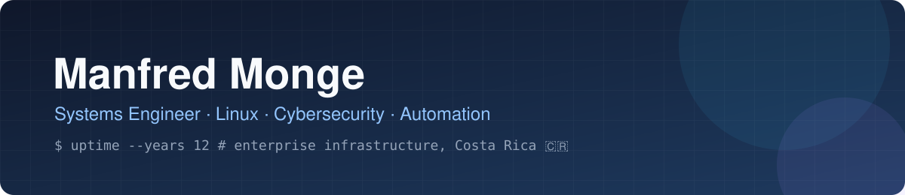

## 👋 About me

Systems Engineer in Cartago, Costa Rica, with **12+ years** in Linux administration, cybersecurity
support and ITIL change management for enterprise clients — IBM, Kyndryl, Kaiser Permanente,
Tek-Experts. Today I work on **IBM QRadar SIEM** support and high-availability deployments.
I like turning repetitive, error-prone manual work into small, well-tested tools.

## 🏆 Certifications & training

**Security**

**Linux & platforms**

**Data & programming**

**Professional**

## 🛠️ What I do

**Systems**

**Security**

**Cloud & containers**

**Observability**

**Automation & data**

**ITSM**

## 🚀 Projects

| Project | What it does | Stack |
|---|---|---|
| [**restaurant-simulation-API**](https://github.com/ManfredM10/restaurant-simulation-API) | A FastAPI service that simulates restaurant orders and exposes `/metrics`, deployed on a local Kubernetes cluster with a full observability stack: Prometheus scraping, Alertmanager rules and Grafana dashboards. An SRE lab end to end. | Python · FastAPI · Docker · Kubernetes (Minikube) · Prometheus · Grafana |
| [**card-installment-tracker**](https://github.com/ManfredM10/card-installment-tracker)  | Tracks credit-card purchases financed in installments. Config-driven rules generate an Excel with live formulas; paid installments are inferred from the date. Tests recalculate the workbook with LibreOffice and check it against the Python model. | Python · openpyxl · pytest · Actions |
| [**landed-cost-pricer**](https://github.com/ManfredM10/landed-cost-pricer)  | Parses supplier invoice PDFs, allocates freight by weight and fees by value, splits cases into sellable units and prices each one with live margins. | Python · Streamlit · pdfplumber · pandas |

The last two grew out of running a small import business on the side: the spreadsheets we filled
by hand became the spec.

## 📊 GitHub

<picture>
  <source media="(prefers-color-scheme: dark)" srcset="https://raw.githubusercontent.com/ManfredM10/ManfredM10/output/github-snake-dark.svg"/>
  
</picture>

## 🌐 Let's connect

*Keep it up. Keep it secure. Automate the rest.* · Cartago, Costa Rica 🇨🇷

